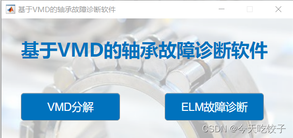
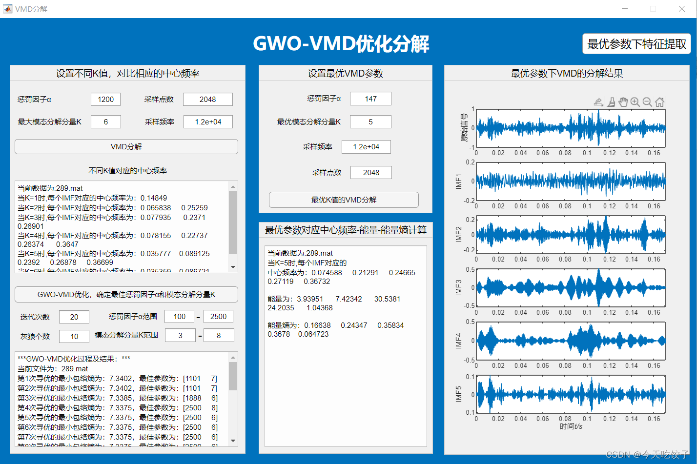
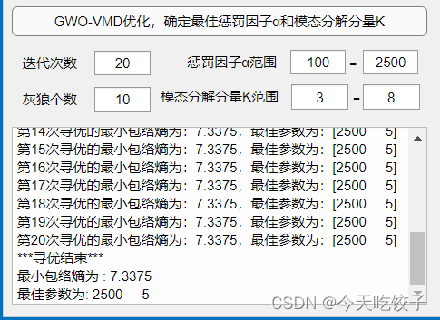
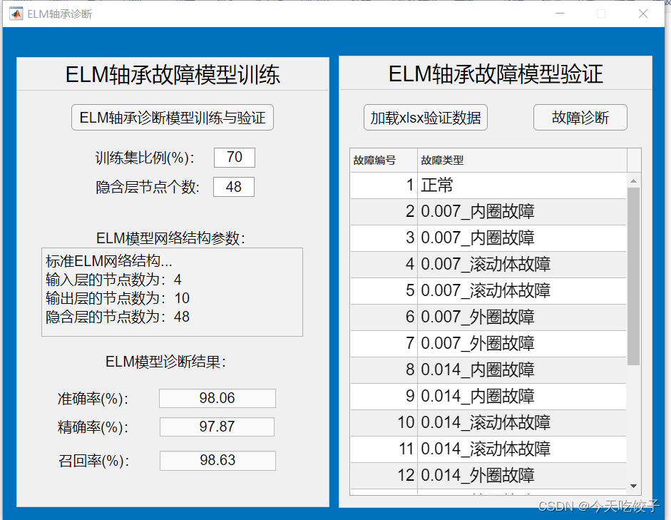
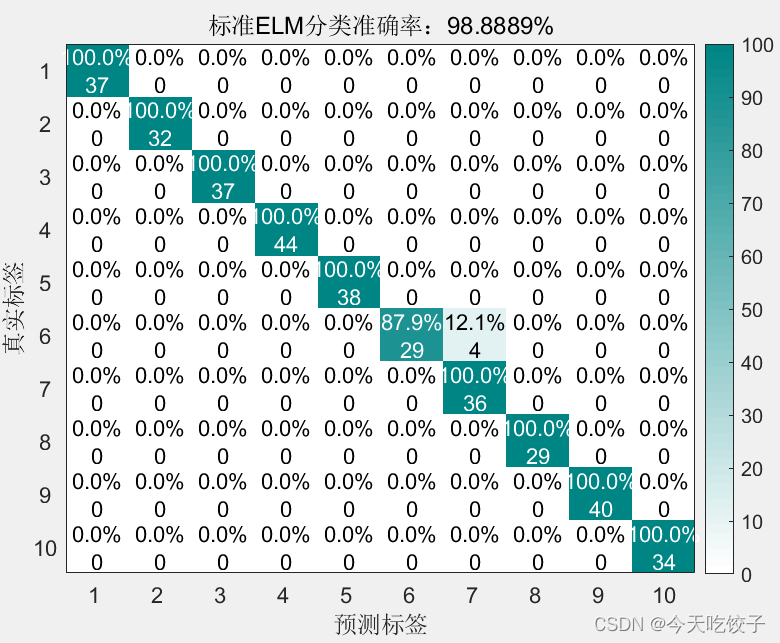
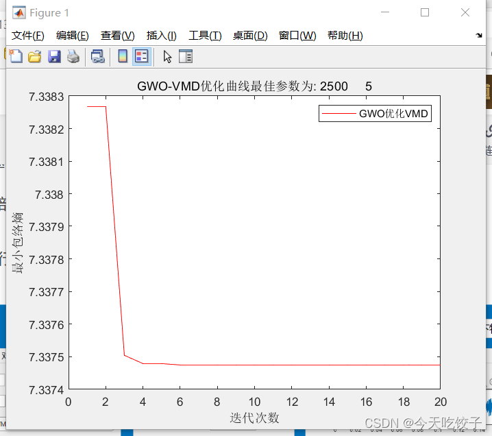
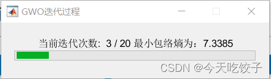
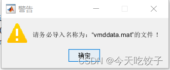

# GWO-VMD-Approach to approximating entropy - Extreme Learning Machine for bearing fault diagnosis software, using Xichu University bearing data as an example, MATLAB APP development.

The gray wolf algorithm is used to optimize two parameters of VMD, with entropic flux as the minimum fitness value. Under optimal parameters, feature vectors are extracted using approximate entropy indicators from data on bearings at Xi Chu University. Finally, an ELM is selected for fault diagnosis. The above program is integrated into MATLABAPP for development.
Firstly, the interfaces of the software are displayed. The software interface includes the VMD optimization decomposition part and the ELM test part.
The GWO-VMD optimization decomposition interface includes the VMD decomposition and VMD optimization in the VMD optimization decomposition part.
In the GWO-VMD optimization part, the best value found during each iteration for optimization and the final result value will be displayed in the display box. The gray wolf algorithm is used for optimization, and the fitness function remains the minimum entropic flux.
Manually setting the parameters for optimizing the VMD will show the VMD decomposition graph under the optimal K value and the center energy, energy entropy, and other parameter indicators corresponding to the optimal parameters.
ELM fault diagnosis interface
This part can also load XLSX data manually for model verification.
Diagnostic results graph and some intermediate interfaces:

## Images

<!-- PAYMENT_BLOCK -->

## Get this dataset

- Payment link (Stripe): [Buy now](https://buy.stripe.com/3cs8yP7sY87d0vu9AB)
- Payment QR code: 

<!-- /PAYMENT_BLOCK -->
